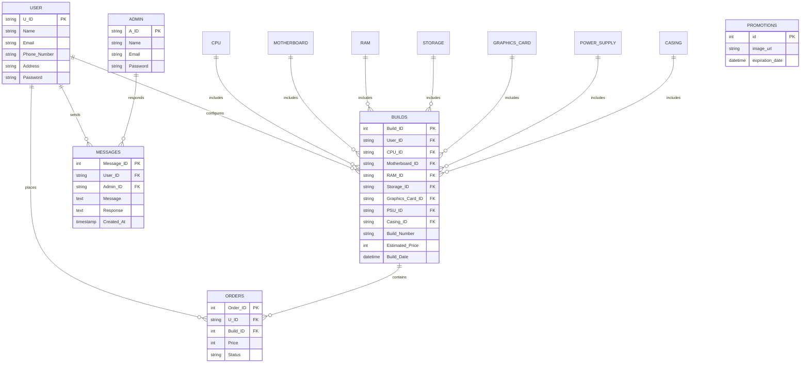

# 🖥️ Custom PC Builder & Management System

[](https://www.php.net/)
[](https://www.mysql.com/)
[](https://www.apachefriends.org/)
[](https://github.com/meawsin/PC-Builder)

A comprehensive, full-stack web application designed for custom PC configuration, hardware compatibility verification, side-by-side component comparison, order fulfillment, and administrative DBMS analytics. Built with **PHP** and **MySQL** as an academic **Database Management System (DBMS)** project.

---

## 📸 Visual Showcase & Feature Walkthrough

### 1. Customer Experience

#### 🏠 Homepage with Active Promotions & Dynamic Countdown
Features live promotional offers with real-time countdown timers and direct access to builder modules.


#### 🔐 User Authentication Portal
Secure access portal supporting role-based authentication for regular users and administrators.


#### ⚙️ Step-by-Step PC Configuration Engine
Dynamic component selection engine that computes real-time system wattage and estimated prices while applying hardware compatibility rules (CPU socket generation, Motherboard RAM support, PSU power headroom, and Casing form factors).


#### 📋 User Builds Dashboard
Users can review their configured PC builds, view detailed specs of all 7 core components, and place direct purchase orders.


#### 📦 Order Tracking & Status
Real-time tracking of placed orders showing build numbers, status updates (*Pending*, *Processing*, *Shipped*, *Delivered*), and invoice links.


#### 🧾 Itemized Order Invoice & Build Sheet
Print-ready build breakdown detailing unit prices, customer contact information, and total order cost.


#### 🔍 Hardware Component Catalog & Search
Search and browse through processors, graphics cards, motherboards, storage, RAM, power supplies, and casings with live specifications.


#### ⚖️ Side-by-Side Product Comparison
Directly compare any two hardware components across specifications (clock, memory, TDP wattage, form factor, and price) within any category.


#### 💬 Technical Inquiry & Expert Consultation
Direct chat interface allowing customers to consult technical experts regarding build compatibility and custom requests.


---

### 2. Administrative Control & DBMS Insights

#### 🎛️ Admin Control Center
Central management dashboard for hardware catalog updates, order processing, and system oversight.


#### 📊 DBMS Insights & Aggregated Business Analytics
Built-in business intelligence interface powered by SQL relational aggregate queries (`COUNT`, `SUM`, `AVG`, `GROUP BY`) displaying user growth, total revenue, average build values, order distribution, and most popular hardware components.


#### 🚚 Order Fulfillment Manager
Interactive order lifecycle manager enabling administrators to update customer order statuses and inspect custom configuration specifications.


#### 📦 Hardware Inventory CRUD Portal
Product management portal allowing admins to add new hardware models, modify existing pricing and specs, or remove discontinued components across 7 hardware categories.


#### 👥 User Account Management
Complete customer roster view showing user IDs, contact records, delivery addresses, and associated order history.


#### ✉️ Customer Inquiry & Support Desk
Dedicated inquiry response portal for administrators to answer technical questions asked by customers.


---

## 🗄️ Database Architecture & Relational Schema

The underlying database `projectdemo1` consists of **13 relational tables** with enforced foreign key constraints:



### Relational Schema Highlights:
- **Foreign Keys**: `builds` links to all 7 hardware component tables (`CPU`, `Motherboard`, `RAM`, `Storage`, `Graphics_Card`, `Power_Supply`, `Casing`) alongside `User`.
- **Integrity**: `orders` connects back to `User` and `builds` to guarantee pricing and build history immutability.
- **Aggregation**: Comprehensive analytical queries power the administrator analytics dashboard.

---

## 🚀 Quick Start & Setup Guide

### 1. Prerequisites
- **PHP**: 8.0 or newer
- **MySQL**: 8.0 or newer (or MariaDB via XAMPP)
- **Web Server**: Apache (via XAMPP) or PHP Built-in Server

### 2. Database Initialization
1. Start your MySQL service.
2. Create the database and import schema & seed data:
```bash
mysql -u root -p -e "CREATE DATABASE IF NOT EXISTS ProjectDemo1;"
mysql -u root -p ProjectDemo1 < "Projects/Table creating codes.txt"
mysql -u root -p ProjectDemo1 < "seed_demo_data.sql"
```

### 3. Database Credentials Configuration
Verify or edit `Projects/connection.php` if your local MySQL settings differ:
```php
$host = "localhost";
$user = "root";
$password = "root";       // Set your local MySQL password
$database = "ProjectDemo1";
```

### 4. Running the Application

#### Option A: PHP Built-in Server (Recommended for quick testing)
```powershell
cd "D:\Projects\PC Builder\Projects"
php -S localhost:8080
```
Then open: [http://localhost:8080/index.php](http://localhost:8080/index.php)

#### Option B: XAMPP / Apache
1. Copy or symlink the `Projects` directory to your XAMPP web root:
   `C:\xampp\htdocs\Projects`
2. Start Apache and MySQL from the XAMPP Control Panel.
3. Open in your browser: [http://localhost/Projects/index.php](http://localhost/Projects/index.php)

---

## 🔑 Test Credentials

| Role | Username | Password | Notes |
| :--- | :--- | :--- | :--- |
| **Customer** | `Mohsin` | `mohsin` | User account with pre-configured custom builds & orders |
| **Customer** | `Sarah Jenkins` | `sarah123` | Customer with budget AMD build & delivered order |
| **Customer** | `Alex Mercer` | `alex2024` | Customer with high-end RTX 3090 workstation build |
| **Administrator** | `John Doe` | `password123` | Full administrative privileges across all modules |
| **Administrator** | `Jane Smith` | `password456` | Full administrative privileges |

---

## 📁 Repository Structure

```text
PC Builder/
├── Projects/                       # Application source code
│   ├── index.php                   # Homepage with promotions & countdown timer
│   ├── building.php                # PC Builder component selection engine
│   ├── compare.php                 # Side-by-side component comparison
│   ├── components.php              # Hardware component catalog (141 components)
│   ├── mybuilds.php                # User's saved builds & order placement
│   ├── orderStatus.php             # Order tracking view
│   ├── printbuild.php              # Itemized build print / invoice sheet
│   ├── ask.php                     # Customer technical inquiry chat
│   ├── login.php                   # Login authentication form
│   ├── signup.php                  # User registration
│   ├── forgot_password.php         # CSRF-protected password reset
│   ├── logout.php                  # Session termination
│   ├── admin_dashboard.php         # Admin control panel
│   ├── Anlytics.php                # DBMS System Insights & Business Analytics
│   ├── manage_orders.php           # Order status management
│   ├── manage_product.php          # Hardware catalog CRUD portal
│   ├── manage_users.php            # Registered user oversight
│   ├── admin_responses.php         # Admin support desk & inquiry replies
│   ├── promotion.php               # Promotional banner upload & management
│   ├── connection.php              # Database connection configuration
│   ├── header.php                  # Universal navigation bar & session state
│   ├── Table creating codes.txt    # Base DDL & 141 component seed script
│   └── uploads/                    # Uploaded promotional banners & assets
├── screenshots/                    # High-resolution screenshots for showcase & portfolio
│   ├── 01_home_page.png
│   ├── 02_user_login.png
│   ├── 03_pc_builder.png
│   ├── 04_my_builds.png
│   ├── 05_order_status.png
│   ├── 06_order_invoice.png
│   ├── 07_component_catalog.png
│   ├── 08_product_comparison.png
│   ├── 09_ask_expert.png
│   ├── 10_admin_dashboard.png
│   ├── 11_dbms_analytics.png
│   ├── 12_manage_orders.png
│   ├── 13_manage_products.png
│   ├── 14_manage_users.png
│   └── 15_admin_responses.png
├── add_more_components.sql         # Expansion SQL adding 70 modern components
├── seed_demo_data.sql              # Additional users, builds, orders & messages
├── capture_all_screenshots.py      # Automated Selenium script to capture all views
├── capture_admin_screenshots.py    # Dedicated admin screenshot automation
└── README.md                       # Complete documentation & portfolio showcase
```

---

## 💼 Portfolio Highlights & Assets

For quick reference in your personal portfolio or presentation slides, all high-resolution PNG screenshots are located in:
`D:\Projects\PC Builder\screenshots\`

### Key Showcase Points:
- **Relational Integrity**: Enforced foreign keys across 8 interrelated tables.
- **Dynamic Compatibility Rules**: Filters motherboards by CPU generation, RAM by DDR standard, and casings by form factor.
- **Aggregated Analytics**: Live business intelligence calculating total system revenue, popular parts, and order fulfillment breakdown using SQL `JOIN` and `GROUP BY`.
- **E-Commerce Lifecycle**: From initial component selection to order placement, status tracking, and printable customer invoice generation.
